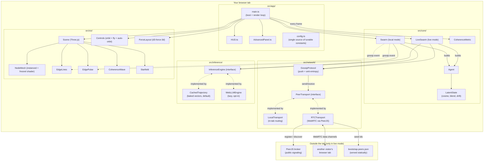
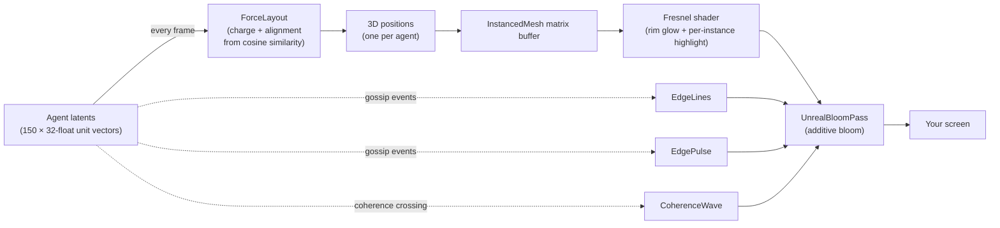

# Choir

> **An interactive 3D metaphor for emergent coherence in a peer-to-peer swarm of software agents. Not a scientific claim.**

→ **[Live demo](https://geoabrahamdev.github.io/Choir/)**

   

---

## This is not a consciousness experiment

Choir visualises what a toy gossip protocol *looks like* when ~150 tiny software agents reach agreement on a shared vector state. It is an artistic metaphor and a technical demo — nothing more. It does not model, demonstrate, or prove consciousness, non-local effects, souls, telepathy, or any metaphysical claim. If the visuals feel evocative, that is the point; please do not read anything scientific into them.

---

## Table of contents

- [What am I looking at?](#what-am-i-looking-at) — pure beginner
- [The 60-second mental model](#the-60-second-mental-model) — beginner
- [Architecture at a glance](#architecture-at-a-glance) — with diagram
- [How the pieces fit — a code tour](#how-the-pieces-fit--a-code-tour) — intermediate
- [Deep dive: the gossip protocol](#deep-dive-the-gossip-protocol) — advanced
- [Deep dive: coherence and the wave](#deep-dive-coherence-and-the-wave) — advanced
- [Deep dive: the three transports and two inference engines](#deep-dive-the-three-transports-and-two-inference-engines) — advanced
- [Rendering pipeline](#rendering-pipeline)
- [Running Choir locally](#running-choir-locally)
- [Tuning knobs](#tuning-knobs)
- [Tech stack](#tech-stack)
- [Roadmap](#roadmap)
- [Known limitations and honest caveats](#known-limitations-and-honest-caveats)
- [Contributing](#contributing)
- [License](#license)

---

## What am I looking at?

Open the [live demo](https://geoabrahamdev.github.io/Choir/) in a modern browser (Chrome, Edge, or Firefox). You will see:

- **Glowing dots** — each dot is one *agent*, a tiny software actor. There are about 150 of them.
- **Lines flashing between dots** — those are *gossip messages*. One agent just told another agent what it is currently thinking.
- **Little travelling beads along the lines** — a *pulse*, showing the direction of a message and when it arrived.
- **A soft purple wave that occasionally expands outward** — the swarm has reached a moment of agreement; the wave is a visual event marker.
- **The HUD in the bottom right** shows:
  - `coherence` — how much the agents agree with each other right now, from 0 % to 100 %
  - `peers` — how many agents are in the swarm
  - `fps` — how smoothly your browser is rendering
  - `mode` — `local` (default — everything runs inside your tab) or `live` (your tab tries to find real other tabs over the internet)
- **A short caption** fades in at the bottom every few seconds, like *"a small choir of 150 tiny minds."*

That is the whole product. There is no login, no backend, no database, nobody tracking you. Everything happens in your browser tab.

---

## The 60-second mental model

Imagine 150 people in a dark room, each holding a glowing marker on a very long arrow. Each person has:

1. **A personality** — their favourite direction to point the arrow, slightly different for each person.
2. **A current direction** — where their arrow is actually pointing right now, which drifts slowly toward their favourite direction over time.
3. **A whisper habit** — every half-second they pick three random strangers in the room and whisper their current direction to them.

When you hear someone else's direction, you tilt your own arrow *a tiny bit* toward theirs — you do not jump all the way there. Keep doing this for a minute and, even though every person has a different favourite direction, the whole room settles into a loose agreement because everyone is gently pulling on everyone else.

That is the entire simulation. The "coherence" meter measures how aligned all the arrows are. When the agreement crosses a threshold, a bright wave announces the moment. That is it.

The dots on screen are those people. The lines are the whispers. The wave is the moment agreement crystallises.

---

## Architecture at a glance



Three things are worth noticing in that diagram:

1. **Nothing outside the tab exists in local (default) mode.** The dashed box `External` is used only when you flip the HUD to `live`. Local mode is the whole picture — a single tab playing with itself.
2. **Everything is behind interfaces.** `PeerTransport` doesn't know whether it's routing in-memory or over WebRTC. `InferenceEngine` doesn't know whether it's reading a baked blob or calling an LLM. Swapping either one is a one-file change.
3. **`config.ts` is the single knob cabinet.** Every tunable number — gossip interval, fanout, blend alpha, drift noise, agent count, the wave threshold, colour palette — lives there. Do not hardcode these anywhere else.

---

## How the pieces fit — a code tour

Start reading at `src/app/main.ts`. In order, it:

1. Registers the cross-origin-isolation service worker (needed only if the user later turns on advanced mode — harmless otherwise).
2. Loads the pre-baked trajectories file (`public/embeddings/trajectories.bin`).
3. Builds a `Scene` (Three.js renderer, camera, bloom post-processing, fog).
4. Builds the viz objects: `NodeMesh`, `EdgeLines`, `EdgePulse`, `CoherenceWave`, `Starfield`, `Controls`.
5. Builds a `HUD` and an `AdvancedPanel`.
6. Depending on the stored mode, builds either a local `Swarm` or a `LiveSwarm`.
7. Enters `requestAnimationFrame` and runs the render loop forever.

The render loop does, every frame:

- Occasionally (every 120 ms) ask the swarm to tick — each agent evolves its latent state.
- Run one step of the force-directed layout so nodes settle into clusters by similarity.
- Push node positions into the instanced mesh buffer, update edge geometry, animate pulses, update the wave.
- Compute current coherence, write it to the HUD.
- If coherence just crossed the threshold, trigger a wave.

The thing driving everything is agents gossiping their latent states, and the thing you see is a direct function of those latent states.

---

## Deep dive: the gossip protocol

File: `src/network/GossipProtocol.ts`.

Choir uses a **push-based epidemic protocol with anti-entropy**, straight out of the distributed-systems literature. Two loops run per agent:

### Push loop — every 500 ms

Each agent picks `FANOUT=3` random peers and sends them a single message:

```
{ fromId: "peer-0042", version: 137, latent: Float32Array(32) }
```

That is the agent's own current state, nothing else. Receiving a message does three things:

1. Compare `version` against what you already have stored for this sender. If yours is newer or equal, drop the message.
2. Otherwise store the new `(fromId, version, latent)` in your local peer table.
3. **Blend** a small fraction `BLEND_ALPHA` of the incoming latent into your own latent, then renormalise to unit length.

Step 3 is where the "coherence" phenomenon comes from. Every blend pulls you a tiny bit toward the person who whispered to you. Do this a thousand times with 150 people in the room and you converge on something close to agreement.

### Anti-entropy loop — every 5 s

Push-based gossip can lose messages (in the local sim we even simulate 2 % packet loss on purpose). Anti-entropy is the repair mechanism: each agent picks one random peer and sends them its entire peer table. Whichever side holds the older copy of each peer's state replaces it.

This guarantees **eventual consistency**: given enough time, every agent will know the current state of every other agent, even on a lossy network.

### Why this specific design?

- **Push-only** is cheap and fast. There is no request/response round-trip for the hot path.
- **Fanout of 3** is the classical choice from the gossip literature; convergence time scales as `log(N) / log(fanout)`. For N=150, this is ~5 rounds of push to reach everyone with high probability.
- **Anti-entropy** means even catastrophic loss (say a 50 % drop rate) still converges eventually — it just takes longer.
- **Version numbers** are per-agent monotonic counters. We never have to compare latent vectors to decide freshness, which would be fragile.

---

## Deep dive: coherence and the wave

File: `src/core/CoherenceMetric.ts`.

The coherence formula is deliberately simple:

```
centroid  = normalise(mean(latent_i)) for all agents i
raw       = mean( cosineSim(latent_i, centroid) )   // in [-1, 1]
coherence = clamp01( (raw + 1) / 2 )                // in [0, 1]
```

A few consequences worth knowing:

- **Random latents give coherence ≈ 0.5**, not 0, because random unit vectors in 32-D have expected cosine ≈ 0, which maps to 0.5 after the squash.
- **The ceiling is not 1.0**, it is whatever the simulation can actually achieve given its competing pulls. In practice, with 6 baked attractor clusters, equilibrium sits around 0.70–0.75. This is a design property, not a bug — a "perfect swarm" would be visually boring.
- **The wave fires on *threshold crossing*, not on every frame above threshold.** `CONFIG.COHERENCE_WAVE_THRESHOLD` is currently `0.78`. When coherence rises through that value (not while it stays above), a single wave is spawned. There is also a 4 s cooldown to prevent flicker.

When a wave fires, `CoherenceWave.ts` expands an additive-blended sphere shell from the swarm centroid outward, with an ease-out cubic over 1.2 seconds. As the shell passes over nodes, `NodeMesh.pulseAt` briefly brightens them — the wave is visible as both the expanding shell and the ripple of flashed nodes it passes.

---

## Deep dive: the three transports and two inference engines

Choir separates *how agents talk* from *what they talk about*. This separation is the whole reason the same visual metaphor can run in three different modes.

### Transports (`PeerTransport` interface)

| Transport | Where messages go | When it is used |
|---|---|---|
| `LocalTransport` | In-memory routing inside one tab, with configurable simulated latency and 2 % drop rate | Default mode. No internet needed. |
| `RTCTransport` | Real WebRTC data channels between browser tabs, signaled via the public PeerJS broker | When the user flips the HUD to `live` |

`GossipProtocol` is written against the `PeerTransport` interface; it never knows which implementation it has. Adding a third transport (say, over a Cloudflare Durable Object) is a one-file change.

### Inference engines (`InferenceEngine` interface)

| Engine | Where latent vectors come from | When it is used |
|---|---|---|
| `CachedTrajectory` | A pre-baked `trajectories.bin` file containing 150 × 500 × 32-float drift paths | Default |
| `WebLLMEngine` | Real on-device LLM inference via `@mlc-ai/web-llm`, with a deterministic random projection from token log-probabilities to the 32-D latent space | When the user explicitly clicks the Advanced panel → on |

The bake script (`scripts/bake-trajectories.ts`) generates the cached trajectories by placing each agent near one of six cluster centroids and drifting it slowly, biased toward that centroid. This gives six visible colour-families in the swarm.

### The live mode handshake

When you flip the HUD to `live`, this sequence happens:

1. A random PeerJS id of the form `choir-<8 hex chars>` is minted.
2. The browser connects to the public PeerJS signaling broker.
3. If the broker opens the id within 10 seconds, the browser fetches `public/bootstrap-peers.json`, merges that with any peer ids remembered from past visits in `localStorage`, and tries to dial up to 12 of them.
4. Each successful WebRTC data channel registers its peer with `GossipProtocol`.
5. The local swarm shrinks to a single local agent — your tab becomes one node in a wider mesh.
6. Remote-peer placeholders are materialised lazily when their first gossip message arrives.

If the broker times out, the app silently falls back to local mode and shows a small HUD note.

The `bootstrap-peers.json` file is currently empty; the first visitor on the live URL will see "waiting for peers." See the roadmap below.

---

## Rendering pipeline



Design choices worth calling out:

- **One `InstancedMesh` for all nodes.** 150 draw calls would kill performance. Instancing means one GPU draw.
- **One `LineSegments` buffer for all edges.** Edges live for 1.5 s with a quadratic fade — written and discarded in a single buffer every frame.
- **A custom fresnel shader for nodes.** Rim glow from the view angle plus a per-instance `aHighlight` attribute the coherence wave pokes as it passes over a node.
- **Additive blending everywhere** in the glowing layers, so overlap bright-sums instead of looking flat.
- **`d3-force-3d`** runs the force simulation: charge (repulsion), weak center attraction, and a custom alignment force that pulls similar latents closer.

---

## Running Choir locally

Prereqs: **Node ≥ 20 LTS**, npm, a modern browser.

```bash
git clone https://github.com/geoabrahamdev/Choir.git
cd Choir
npm install
npm run bake        # generates public/embeddings/trajectories.bin (one-time)
npm run dev         # http://localhost:5173
npm test            # 22 unit tests
npm run build       # production bundle into dist/
```

Preview the production build at the right base path:

```bash
CHOIR_BASE=/ npx vite preview
```

The Pages deploy pipeline is just `npm ci && npm run bake && npm test && npm run build`, uploaded by `.github/workflows/deploy.yml` on every push to `main`.

---

## Tuning knobs

All in `src/app/config.ts`. The ones you are most likely to touch:

| Constant | Default | What it does |
|---|---|---|
| `AGENT_COUNT_SINGLE_TAB` | 150 | How many agents in local mode. 300 is still smooth on integrated graphics. |
| `LATENT_DIM` | 32 | Dimensionality of each agent's state vector. |
| `GOSSIP_INTERVAL_MS` | 500 | How often each agent pushes. Lower → faster convergence, higher load. |
| `FANOUT` | 3 | How many peers each push targets. 2 to 5 is a healthy range. |
| `BLEND_ALPHA` | 0.07 | How strongly a received message pulls your own latent. Higher is *not* always better (see caveats). |
| `ANTI_ENTROPY_MS` | 5000 | How often the repair pass runs. |
| `DRIFT_NOISE` | 0.02 | Per-tick gaussian noise amplitude on each latent. Think of it as how restless each agent is. |
| `COHERENCE_WAVE_THRESHOLD` | 0.78 | What coherence level triggers the wave. See the honest caveats below. |
| `CLUSTER_COUNT` | 6 | How many attractor clusters the bake script uses. Fewer → higher equilibrium coherence. |
| `MAX_RENDER_NODES` | 500 | Hard cap on instanced mesh size. |

---

## Tech stack

- **TypeScript 5.4** + **Vite 5.2** — the whole build, dev server, and type-check
- **Three.js 0.162** — WebGL rendering, `UnrealBloomPass`, custom `ShaderMaterial`
- **d3-force-3d 3.0** — the force-directed layout, in 3D
- **PeerJS 1.5** + **simple-peer 9.11** — WebRTC signaling and data channels (lazy-loaded, only in live mode)
- **@mlc-ai/web-llm** — on-device LLM inference (lazy, opt-in only)
- **Vitest 1.4** — 22 unit tests covering latent math, coherence, gossip, live-swarm, node-mesh, and the WebLLM wrapper
- **GitHub Pages** + **GitHub Actions** — hosting and CI

**No backend. No database. No analytics. No accounts.** The only server contact ever made is to the PeerJS signaling broker, and only if you flip the HUD to `live`.

**Bundle sizes (gzipped):**
- Main bundle, loaded always: **~144 KB**
- RTCTransport chunk, lazy-loaded when live mode is first used: **~25 KB**
- WebLLM wrapper, lazy-loaded when advanced mode is first enabled: **~1 KB**
- `@mlc-ai/web-llm` runtime, only if advanced mode is actually enabled: **~2.2 MB** (plus a one-time ~500 MB model download, cached in IndexedDB)

The whole cold-start payload for a first-time visitor in default mode is **under 160 KB** of code + the 9.58 MB `trajectories.bin` blob.

---

## Roadmap

- **M1** — single-tab swarm with faked latent states. ✅ live
- **M2** — visual polish: fresnel shader, starfield, auto-orbit, bloom tune, 1.2 s ease-out coherence wave. ✅ live
- **M3** — real peer-to-peer over WebRTC with a Local/Live toggle, bootstrap discovery, graceful signaling fallback. ✅ code live; multi-browser verification pending
- **M4** *(optional, opt-in)* — real LLM inference in the browser via `@mlc-ai/web-llm`, gated behind WebGPU + ~500 MB model download. ✅ code live; GPU verification pending

---

## Known limitations and honest caveats

This section is kept deliberately blunt because the project is in preview.

- **`bootstrap-peers.json` ships empty.** The first visitor in live mode has no one to dial. A real deployment needs either a seed peer id committed to the file, a tiny Cloudflare Worker running `peerjs-server`, or a GitHub Action that keeps the seed list warm.
- **The coherence ceiling is a design property, not a bug.** With `CLUSTER_COUNT=6`, the global coherence plateaus around 0.72–0.75. Raising `BLEND_ALPHA` does not lift this ceiling — it is set by the shape of the baked trajectories. The two knobs that actually raise it are `CLUSTER_COUNT` (lower it) or changing `Swarm.tick()` to blend the trajectory into the current latent instead of replacing it.
- **The 0.78 wave threshold is aspirational on the current bake.** If the swarm equilibrium sits at ~0.73, the wave will fire rarely or never. Lower the threshold to the actual equilibrium plus some headroom, *or* reduce `CLUSTER_COUNT` to raise the equilibrium. Tune one knob at a time.
- **M3 convergence across two real devices has not been verified.** The `PeerTransport` interface is unit-tested via `LocalTransport`, but WebRTC-specific paths (dial failure, NAT traversal, signaling timeout) need two browsers on different networks.
- **M4 real-LLM dynamics have not been observed on a GPU laptop** by the project owner. The code path pre-flights WebGPU + cross-origin isolation and falls back cleanly, but the "qualitatively different dynamics" promise is unproven.
- **No `demo.mp4`.** M2.8 asked for a short screen capture committed to the repo. Not done yet.
- **Choir is a visual metaphor.** It is tempting to read deeper meaning into emergent coherence; please don't. See the disclaimer above.

---

## Contributing

This is Geo's personal hobby project. Issues and small PRs are welcome but nothing is guaranteed. The `.agent/` directory in the repo documents the handoff protocol used when AI assistants are helping with the code — if you are a human contributor, you can ignore it.

---

## License

MIT — see [LICENSE](./LICENSE).
